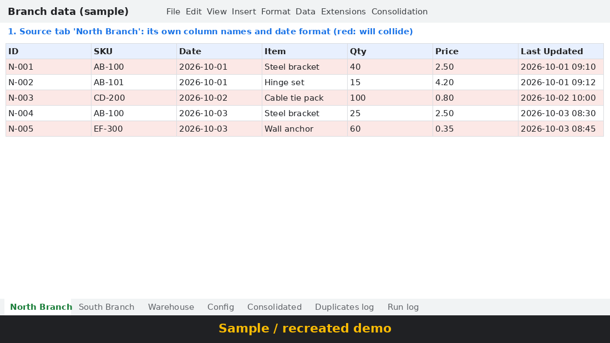

# Sheet Consolidation (Google Apps Script sample)

> Sample project with fictional data. The demo GIF is a recreated screen, not a recording of a live Google account.

## Problem
Branches and departments keep their own Google Sheets. Column names differ ("SKU", "Product Code", "item_code"), dates come in different formats, and the same record is often entered in two places. Before data can move into an ERP, someone has to copy everything into one sheet and clean it by hand.

## How it works
1. **Config** tab maps each source tab's columns to one standard set: `record_id, sku, date, item_name, qty, unit_price, branch, updated_at`. Adding a new source is a few rows in Config, no code change. Optional `spreadsheet_id` column: blank means the tab is in this file; a file ID means the tab is read from that separate spreadsheet (`SpreadsheetApp.openById`). The separate-file path is not yet tested in real Google; it is checked only with the local stub test.
2. **Consolidation > Run consolidation** (custom menu) reads every source tab listed in Config.
3. Each row is normalized: SKU cleaned (`ab 100`, `ab_100`, `AB100` become `AB-100`), dates parsed per source (`YMD`, `DMY`, `MDY`), currency symbols stripped from numbers.
4. Duplicate rows are skipped and logged (rule below).
5. Results go to **Consolidated**, skipped duplicates to **Duplicates log**, and one line per run to **Run log** (rows read, written, skipped, errors).

## Duplicate rule
- Key: same `sku` + same `date` (calendar day).
- Kept: the row with the latest `updated_at`. On a tie, the first row read (Config order) is kept.
- Every skipped row is written to Duplicates log with the key, its source cell reference, the source that was kept, and the reason. Nothing is deleted from the source tabs.

## Setup
1. Create a Google Sheet and import the CSVs in `sample_data/` as tabs named `North Branch`, `South Branch`, `Warehouse` (and `Config` from `config.csv`, or use the menu item *Create Config sheet template*).
2. Extensions > Apps Script. Paste `src/Code.gs`; replace the manifest with `src/appsscript.json` (or use `clasp push`).
3. Reload the sheet. Use **Consolidation > Run consolidation** and approve the permission prompt.
4. Separate files (optional): put the source file ID in Config `spreadsheet_id`. Because of this, `appsscript.json` requests the full `spreadsheets` scope, so Google's authorization screen asks for access to spreadsheets you can open, not only this file. If all sources are in one file, you can switch the scope back to `spreadsheets.currentonly`.

With the sample data: 13 rows read, 9 consolidated, 4 duplicate rows skipped and logged (checked locally with `tests/local_check.js`, which runs the same code against stubbed Sheets objects; `SEPARATE=1` runs the same check with Warehouse in a separate fake file).

## Files
- `src/Code.gs`, `src/appsscript.json`: the script
- `sample_data/*.csv`: fictional source tabs and Config
- `tests/local_check.js`: Node logic check (no Google account needed)
- `demo/demo.gif`: recreated screens, about 30 seconds

## Limits
- Source tabs in separate files are supported through `spreadsheet_id`, but this path is not yet tested in real Google.
- Full rebuild each run; the Consolidated tab is overwritten. Not yet tested on large data.
- Rows with an unreadable date or empty SKU are skipped and counted in Run log.
- No ERP push yet. The Consolidated tab is the clean staging layer for that step.
- No time-driven trigger is installed by default (can be added with one line).
