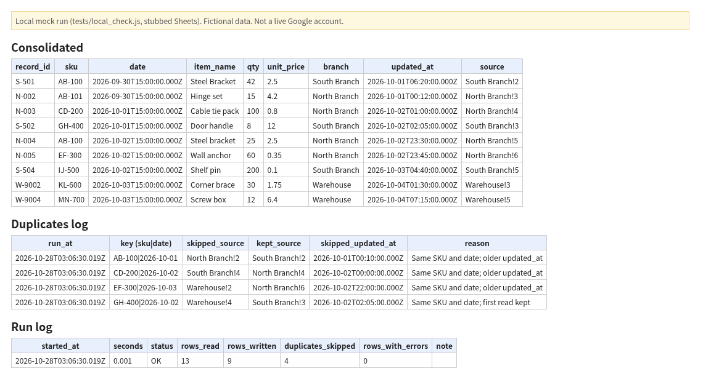
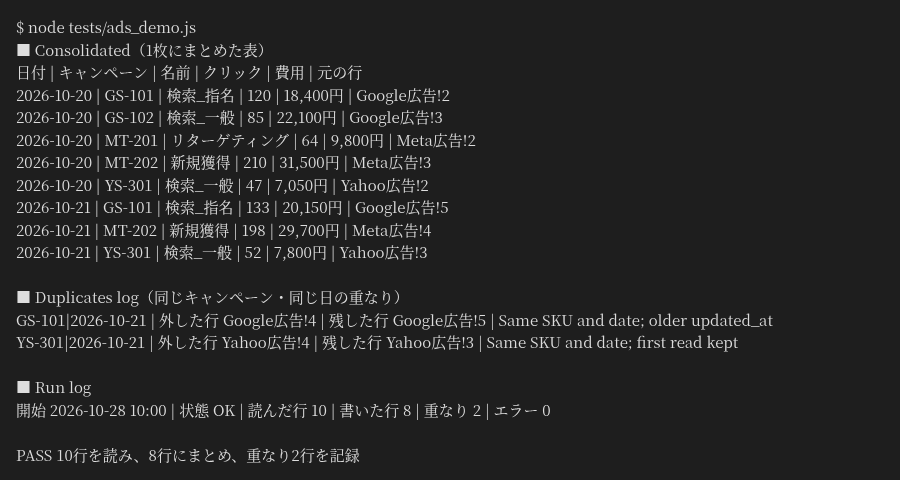

# Sheet Consolidation (Google Apps Script sample)

For operations or accounting staff who copy branch spreadsheets into one sheet by hand before an ERP import.

**Effect:** the hand copy-and-clean step becomes one menu run that merges the tabs, fixes SKU and date formats, and logs every skipped duplicate.

**日本語：** 媒体ごとに列名や日付の形がちがう表を、コードを変えずに設定（Config）だけで1枚にまとめ、重なった行は消さずに記録します。広告3媒体の書き出し（架空）での例は「[広告レポートでの例](#広告レポートでの例日本語)」にあります。

With the sample data, one run reads 13 rows, writes 9 and logs 4 duplicates. The image above is the output of the local test `tests/local_check.js` (stubbed Sheets objects). The GIF below is a run in a real Google Sheets file and shows the same counts: 13 read, 9 written, 4 duplicates, 0 errors. All data is fictional.

Recorded in a real Google Sheets file with fictional data (one spreadsheet, tabs in the same file). Reading from another file by ID has not been tested live yet.

## 広告レポートでの例（日本語）

Google広告・Meta広告・Yahoo広告の書き出しを想定した架空の表（`sample_data/ads/`）を、`sample_data/ads/config_ads.csv` の設定だけで1枚にまとめた例です。`src/Code.gs` は変えていません。画像は、Google のサービスを偽物に置き換えた模擬環境で `node tests/ads_demo.js` を実行したときの実際の出力です（実行日時は 2026-10-28 10:00 日本時間に固定）。この広告データは、まだ本物の Google スプレッドシートでは実行していません。

- 列名のちがい（「費用」「amount_spent」「コスト」など）は Config で同じ列に当てています。在庫向けの標準列をそのまま使い、キャンペーンIDを `sku`、クリック数を `qty`、費用を `unit_price` に入れています
- キャンペーンIDの書き方のちがい（`gs 101`、`MT_201`、`YS301`）は `GS-101` の形にそろえます。日付は媒体ごとの形（年月日・月日年）を読み分けます。「¥18,400」のような記号やカンマは外して数にします
- 10行を読み、8行にまとめ、重なり2行を Duplicates log に記録しました。Google広告の10/21分は2回書き出されたため新しい方を残し、Yahoo広告は同じ行が2回入っていたため先に読んだ方を残しています。理由の欄はスクリプトの英語のままです
- Google上での確かめ方：`sample_data/ads/` の4つのCSVを「Config」「Google広告」「Meta広告」「Yahoo広告」のタブとして読み込み、メニュー **Consolidation > Run consolidation** を実行して、Run log が読んだ行10・書いた行8・重なり2になるかを見ます

## Problem
Branches and departments keep their own Google Sheets. Column names differ ("SKU", "Product Code", "item_code"), dates come in different formats, and the same record is often entered in two places. Before data can move into an ERP, someone has to copy everything into one sheet and clean it by hand.

## How it works
1. **Config** tab maps each source tab's columns to one standard set: `record_id, sku, date, item_name, qty, unit_price, branch, updated_at`. Adding a new source is a few rows in Config, no code change. Optional `spreadsheet_id` column: blank means the tab is in this file; a file ID means the tab is read from that separate spreadsheet (`SpreadsheetApp.openById`). The separate-file path is not yet tested in real Google; it is checked only with the local stub test.
2. **Consolidation > Run consolidation** (custom menu) reads every source tab listed in Config.
3. Each row is normalized: SKU cleaned (`ab 100`, `ab_100`, `AB100` become `AB-100`), dates parsed per source (`YMD`, `DMY`, `MDY`), currency symbols stripped from numbers.
4. Duplicate rows are skipped and logged (rule below).
5. Results go to **Consolidated**, skipped duplicates to **Duplicates log**, and one line per run to **Run log** (rows read, written, skipped, errors).

## Duplicate rule
- Key: same `sku` + same `date` (calendar day).
- Kept: the row with the latest `updated_at`. On a tie, the first row read (Config order) is kept.
- Every skipped row is written to Duplicates log with the key, its source cell reference, the source that was kept, and the reason. Nothing is deleted from the source tabs.

## Setup
1. Create a Google Sheet and import the CSVs in `sample_data/` as tabs named `North Branch`, `South Branch`, `Warehouse` (and `Config` from `config.csv`, or use the menu item *Create Config sheet template*).
2. Extensions > Apps Script. Paste `src/Code.gs`; replace the manifest with `src/appsscript.json` (or use `clasp push`).
   シートの時刻を合わせる: スプレッドシートの「ファイル > 設定」で、タイムゾーンを「(GMT+09:00) 東京」(Asia/Tokyo) にして保存します。日付はこのシートの時刻で読み書きするため、別の地域のままだと表示がその地域の日付になります。
   日付の表示の形は地域の設定で変わります。そろえるのはタイムゾーンだけで構いません。
3. Reload the sheet. Use **Consolidation > Run consolidation** and approve the permission prompt.
4. Separate files (optional): put the source file ID in Config `spreadsheet_id`. Because of this, `appsscript.json` requests the full `spreadsheets` scope, so Google's authorization screen asks for access to spreadsheets you can open, not only this file. If all sources are in one file, you can switch the scope back to `spreadsheets.currentonly`.

With the sample data: 13 rows read, 9 consolidated, 4 duplicate rows skipped and logged (checked locally with `tests/local_check.js`, which runs the same code against stubbed Sheets objects; `SEPARATE=1` runs the same check with Warehouse in a separate fake file).

## Files
- `src/Code.gs`, `src/appsscript.json`: the script
- `sample_data/*.csv`: fictional source tabs and Config
- `tests/local_check.js`: Node logic check (no Google account needed)
- `sample_data/ads/`, `tests/ads_demo.js`, `demo/ads_local_output.png`: fictional ad-platform exports merged with Config only (local mock run, Japanese)
- `demo/demo.gif`: 5 screenshots of a real Google Sheets run with fictional data, 10 seconds
- `demo/local_run_output.png`: output tables from `tests/local_check.js` (local mock run)

## Limits
- Source tabs in separate files are supported through `spreadsheet_id`, but this path is not yet tested in real Google.
- Full rebuild each run; the Consolidated tab is overwritten. Not yet tested on large data.
- Rows with an unreadable date or empty SKU are skipped and counted in Run log.
- No ERP push yet. The Consolidated tab is the clean staging layer for that step.
- No time-driven trigger is installed by default (can be added with one line).
